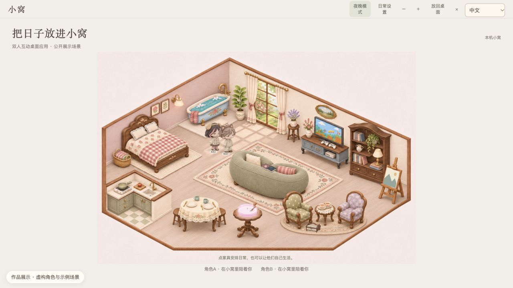
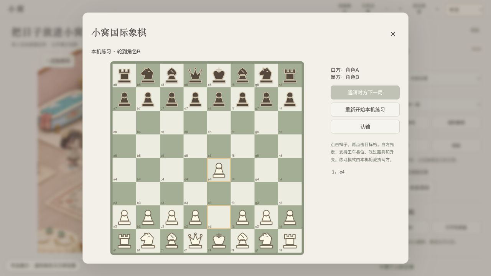
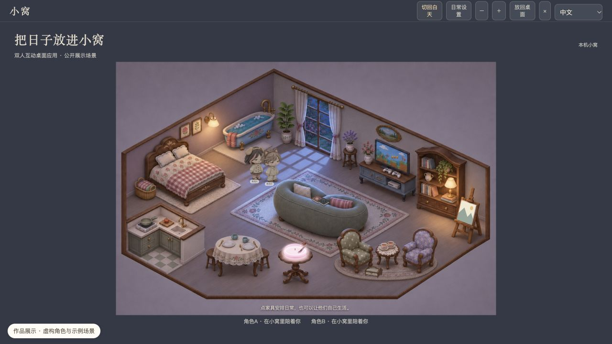

# 悄悄话 Little Notes

一个面向双人远程互动的 macOS 桌面应用。把简短消息、手绘小画和共享小窝放在桌面上，让日常交流多一点轻松的互动。

**个人项目 · 产品设计 · AI 辅助开发 · macOS 桌面应用**

## 项目想法

聊天软件适合完整的对话，但有时只是想留一句话、分享一张小画，或在各自忙碌时保留一点陪伴感。悄悄话围绕这些短暂而具体的交流需求，设计了桌面角色、点击查看的消息提醒，以及可以共同互动的小窝。

## 主要功能

| 模块 | 已实现的功能 |
| --- | --- |
| 桌面消息 | 文字、手绘与照片传送；多种提醒形式；点击后查看内容与快捷回复 |
| 共享小窝 | 角色活动、家具互动、日夜氛围切换，以及阅读、做饭等虚拟日常 |
| 互动小游戏 | 国际象棋、2048 与翻牌；国际象棋提供本机练习及双人联机流程 |
| 个性化设置 | 角色外观、组件大小、消息框背景及贴纸设置 |
| 应用维护 | macOS 应用打包、版本发布与应用内更新 |

### 互动界面

### 夜间场景

## 我做了什么

- 从日常交流场景出发，确定产品功能、界面布局和操作流程，将想法整理为可执行的开发任务。
- 使用 Codex 辅助编写和修改代码，结合 Skills 调用、任务拆解与多轮反馈，逐步完成应用功能和交互细节。
- 在实际试用中检查消息提醒、窗口层级、场景操作及更新流程，持续排查问题、调整体验。
- 通过 GitHub Releases 发布版本，并接入 Sparkle 应用内更新，完成从功能开发到版本交付的实践。

## 实现方式

前端使用 HTML、CSS 和 JavaScript，结合 macOS 原生窗口与 WebKit 桥接实现桌面交互。消息使用 MQTT over WSS 传输，内容通过 AES-GCM 加密；本机设置和历史记录在本地保存。应用更新由 Sparkle 与 GitHub Releases 配合完成。

本项目是个人原型：消息收发需要双方联网、保持应用运行，暂不支持离线消息补发。界面素材制作与代码实现均有 AI 工具辅助，第三方组件及素材的权利归各自权利人所有。

## 关于本展示

这里展示的是项目功能、设计思路和实际界面。截图从隔离的展示环境生成，使用虚构角色与示例场景，不包含真实聊天、配对信息或个人设置。本仓库不提供日常使用版安装包，也不连接私人消息通道。
